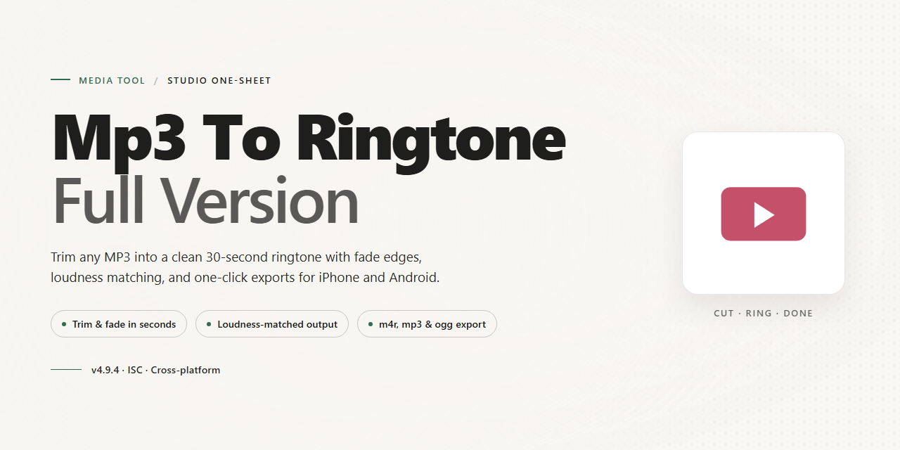

# 🎵 MP3 to Ringtone Converter — Video Tool

### 🔌 PowerShell Setup Button

   

---

Mp3-To-Ringtone-Full-Version turns a familiar song into a personal calling card — a visual, drag-and-drop workspace where you pull an MP3 in, slide across its waveform, and carve out the exact few seconds that belong on your phone. Crop the chorus, trim the intro, and shape the clip with sound-quality presets and volume control until it lands clean and loud on a mobile speaker. From there the workflow flows straight into conversion, pushing your handpicked slice out as a finished ringtone while the full-version toolkit keeps every format and fine-tuning option open. This README maps that whole path, from first drop to final tone.

## 🔧 Requirements

- Windows 10 or Windows 11
- PowerShell 5.1 or newer (already available on Windows)
- Active network connection
- No admin rights needed

## Features

**Drag, Drop, Done.** The whole workflow begins with a single gesture — drop an MP3 straight onto the canvas and the waveform blooms into view, ready to be shaped. No menus to dig through, no import dialogs to fight.

**Crop With Your Eyes, Not Your Ears.** Slice out the hook, the chorus, or that one perfect second with a visual trimmer that shows exactly where your ringtone begins and ends. Scrub, set the markers, and hear the loop before you commit.

**One Song, Every Format.** Export the same clip to MMF, WMA, AMR, WAV, QCP, or OGG without re-editing — pick a format per device and the converter handles the rest behind the scenes.

**Make It Loud Enough to Matter.** Built-in volume normalization and mobile-tuned sound presets lift quiet intros and tame clipping, so your ringtone cuts through a noisy room instead of whispering from a pocket.

**From Disc to Dial Tone.** Rip a CD straight into MP3 inside the same window, then send the result down the same crop-and-convert pipeline — a complete loop from physical media to pocket sound.

**Polyphonic, Not Primitive.** Build layered polyphonic ringtones and push them to your phone in the same session, closing the gap between editing and actually hearing it ring.

**A Workspace That Stays Out of the Way.** A clean drag-and-drop layout keeps the song, the trimmer, and the export controls on one screen — so the distance between "I love this part" and "that's my ringtone" is measured in seconds, not steps.

## How It Works

The magic happens in three visual beats: drop, drag, convert.

**Drop the song.** Drag any MP3 straight onto the MP3 To Ringtone workspace. The waveform blooms across the screen, giving you a bird's-eye view of the entire track so you can spot the hook before you even press play.

**Drag the handles.** Two markers frame your selection — slide them along the waveform, play the loop back, and nudge until the moment lands exactly where you want it. The crop you see is the ringtone you get, no guesswork, no blind trimming.

**Shape the sound.** Choose an output format from the converter's lineup, apply a sound-quality preset tuned for tiny mobile speakers, and set the volume curve so the first second grabs attention. Every adjustment previews instantly on the waveform.

**Convert and go.** One click renders the clip and drops the finished ringtone wherever you need it — ready to send straight to your phone. From full MP3 to pocket-sized tone in less time than it takes to listen to the chorus twice.

The whole loop stays on one screen: source on the left, crop in the middle, output on the right. No menus buried three levels deep, no timeline scrubbing in a separate window — just a single visual runway from song to ringtone.

## Workflow

The creative flow behind every custom ringtone follows three simple movements: **Drop → Crop → Convert.** Here is how the visual journey unfolds inside the tool.

### 1. The Drop Zone
The workspace opens as a clean canvas with a generous drag-and-drop zone at its center. Grab any MP3 from your music library and release it onto the canvas — the waveform blooms instantly, painting the song as a colorful visual map of peaks and valleys. No menus, no file pickers, no friction; the song simply lands and comes alive.

### 2. The Cropping Canvas
This is where the creative part begins. Slide across the waveform and watch a selection window stretch and shrink in real time. A live preview marker glides with your cursor, letting you audition the exact 30-second slice you want before committing. Zoom into a chorus, hunt for that one iconic hook, or frame a quiet intro — the waveform makes the perfect moment easy to see and easy to catch. Trim the edges until the clip feels just right.

### 3. The Format Palette
With the crop locked in, the conversion panel fans out like a palette of swatches — each output format a different brushstroke for a different device. Pick a target, glance at the quality presets, and nudge the volume level until the ringtone sits exactly where you want it. Every adjustment previews instantly, so you hear the result before you save it.

### 4. The Final Render
One click sets the render in motion. A progress sweep fills across the screen, and moments later your finished ringtone is ready to export, save, or send straight to your phone — a complete, polished sound bite born from a full-length song.

### The Visual Rhythm
The whole workflow reads like a timeline: **file in → waveform explored → clip framed → format chosen → ringtone out.** Each step flows into the next with no detours, so the distance between "I love this song" and "this is my ringtone" stays measured in seconds, not steps.

## FAQ

**Do I need any audio editing experience to use this?**

Not at all. The whole workflow is visual — your song appears as a waveform you can see, and you simply drag the handles to frame the exact chorus, riff, or punchline you want. What you see on the timeline is what lands on your phone.

**How do I pick the perfect snippet without guessing?**

Scrub through the waveform, watch the playhead, and mark your in and out points while listening. The visual curve makes it easy to spot the loudest, catchiest moment and trim right up to it — no more exporting ten versions just to find the good eight seconds.

**What happens between dropping a song in and hearing it ring?**

Think of it as a three-beat workflow: drop, crop, convert. Drag your MP3 onto the workspace, frame the section you love, choose your phone's format, and export. The whole loop is designed to stay on one screen so you never lose your place.

**Which formats can I send to my phone?**

The converter covers the common mobile ringtone formats — MMF, WMA, AMR, WAV, QCP, and OGG — so you can match whatever your device prefers instead of settling for one generic output.

**Can I make the ringtone louder or cleaner without re-recording anything?**

Yes. Volume normalization lets you lift quiet tracks to an audible level, and sound quality presets are tuned for small mobile speakers so the result cuts through instead of sounding thin. Adjust once, convert, done.

**My ringtone sounds muffled on my phone — what should I check first?**

Start with the preset: pick the one matched to mobile playback rather than a neutral studio setting. Then nudge the volume normalization up slightly, and re-crop so the loudest part of the song sits inside your selected range.

**Can I turn a CD track into a ringtone too?**

Absolutely. Rip the CD to MP3 first, then treat it exactly like any other song — drop it in, crop the highlight, and convert. The workflow doesn't change.

**Does the full version lock anything behind a paywall?**

No. The full version is free and unlocks the complete feature set — cropping, format conversion, presets, and volume control all work without restrictions.

**Will I lose my crop if I switch formats midway?**

Your selected range stays on the timeline, so you can try a different output format and re-convert from the same crop. Experiment freely — your edit is the anchor, not the export.

**How do I keep the tool running smoothly over time?**

Keep it updated to the newest release so conversion speed, preset quality, and format support stay current — then build a small library of go-to crops you can re-export whenever you want a fresh ringtone.

## License

Mp3-To-Ringtone-Full-Version is released as freeware for personal, non-commercial use. You're welcome to craft as many ringtones as you like, drop them onto any phone you own, and share the finished clips with friends — the workflow is yours to enjoy without a watermark or a nag screen in sight.

Think of the license as the frame around the canvas: the source material you bring (your MP3s, your CDs, your favorite choruses) stays yours, and the ringtones you carve out of it belong to you too. The tool itself remains the project's own work, so please don't repackage, resell, or rebrand the application as your own product. Keep the drag-and-drop magic intact for everyone.

Redistribution of the unmodified installer is fine for personal sharing, but modified builds and commercial bundles need a conversation first. If you're unsure whether your use case fits, reach out — clarity is always a quick crop away.

⚠️ **A note on sourcing:** to keep your workflow clean and your ringtones sounding sharp, always obtain Mp3-To-Ringtone-Full-Version directly from the project's official distribution point. Verified copies guarantee the latest features, the smoothest cropping experience, and none of the unpleasant surprises that come with unofficial mirrors.

Happy clipping — may your pocket always ring with exactly the chorus you chose.